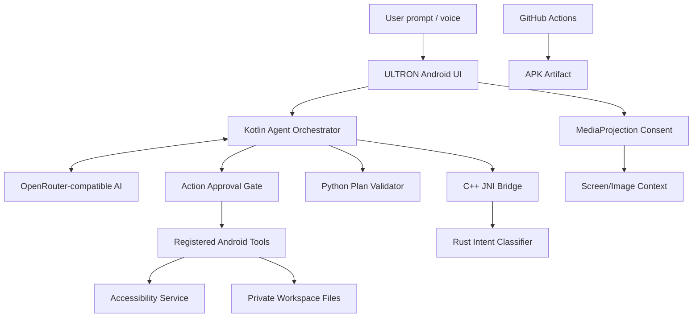

# ⚡ ULTRON AI

### **Personal AI Assistant · Android Automation · Coding Workspace**

*Designed and engineered by **Ultra Abdullah***

---

<b><i>“Your device. Your commands. Your approval.”</i></b>

**A mobile-first AI assistant project that brings conversational AI, permission-based Android actions and a coding workspace together.**

---

## 🌌 System Overview

**ULTRON AI** is an Android assistant project built around a native Kotlin application and a multi-language runtime. Its goal is to let you talk to an AI agent, work with code and project files, inspect a screen after consent, and request supported Android actions.

ULTRON is actively being developed. This repository documents the current foundations and the planned direction; it does not claim that every advanced feature is production-ready.

### ✨ Core Direction

- **AI Conversation:** Connect to an OpenAI-compatible provider through the configured OpenRouter client.
- **Android UI Automation:** Use Android Accessibility APIs for screen inspection and user-approved interactions.
- **Voice Input:** Submit spoken prompts through Android speech recognition where supported.
- **Coding Workspace:** Create and manage files inside the app's private workspace.
- **Screen Understanding:** Capture screen content only after the Android system's MediaProjection consent flow.
- **Native Runtime:** Combine Kotlin orchestration with a Rust library and a C++ JNI bridge.
- **Remote APK Builds:** Compile the Android project on GitHub Actions and download the artifact from a successful run.

---

## 🧠 Runtime Architecture

The app uses separate layers so that Android permissions, AI decisions and native helper code do not become one unrestricted execution surface.

### 🧬 Technology Stack

| Layer | Technology | Responsibility |
|---|---|---|
| Android application | Kotlin | Lifecycle, permissions and agent orchestration |
| Interface | Jetpack Compose | Native Android user interface |
| Native bridge | C++ / JNI | Connect Kotlin to the Rust library |
| Native helper | Rust | Deterministic intent classification |
| Embedded runtime | Python 3.11 / Chaquopy | Structured plan validation |
| AI provider | OpenRouter-compatible API | Model responses and tool-call proposals |
| Device interaction | Android Accessibility Service | Permission-based UI inspection/actions |
| Screen capture | Android MediaProjection | User-consented screen capture |
| Build pipeline | GitHub Actions | Remote APK compilation and artifact upload |

> Rust classification and Python validation are deterministic helper components. They are not separate AI models and do not provide unrestricted shell or device access.

---

## 📱 Feature Status

| Feature | Current status |
|---|---|
| Native Android app foundation | Implemented |
| OpenRouter-compatible chat client | Foundation |
| Encrypted credential storage | Foundation |
| Voice input | Foundation |
| Private workspace file tools | Foundation |
| Accessibility service registration | Integrated; device testing required |
| Screen capture consent integration | Foundation; device testing required |
| AI tool-calling and approval flow | Foundation |
| Rust + JNI + Python helper layers | Added; CI build verification pending |
| GitHub Actions APK pipeline | Workflow configured; latest run must pass before APK is considered available |
| Full autonomous multi-step phone operation | In development |
| Self-repairing code agent | Planned |

### 📲 Android Automation

The intended accessibility toolset includes:

- Read visible UI text and accessible node information.
- Tap a visible target or a coordinate.
- Swipe and scroll through an app.
- Enter text into a focused field.
- Navigate Back, Home and Recents.
- Launch an installed application when the required intent is available.

**Important:** Android requires the device owner to enable the Accessibility Service in Settings. Actions should be scoped to the user's request and require confirmation where appropriate. Secure screens, passwords, OTPs and payment confirmations must not be bypassed.

---

## 🎛️ Interaction Flow

1. Give ULTRON a text or voice instruction.
2. The AI proposes a structured response or registered tool call.
3. ULTRON validates the request and checks whether approval is required.
4. The user reviews and approves a sensitive action.
5. The app executes the supported operation and reports its result.

No hidden screen recording or silent permission activation is intended.

---

## ⚙️ Setup

### Requirements

- Android 8.0 (API 26) or newer.
- Internet connection for remote AI features.
- An OpenRouter API key and a model supported by the provider.
- Accessibility permission only if you want Android UI automation.
- Screen-capture consent each time the Android system requires it.

### Run the Android project

1. Clone or fork this repository.
2. Open the project in Android Studio or a compatible Android Gradle environment.
3. Allow Gradle to sync and download dependencies.
4. Run the `app` configuration on an Android device.
5. Add your provider API key inside the app's settings.
6. Enable Accessibility manually in Android Settings only if you want to test UI automation.

Never commit API keys, passwords or access tokens. Keep personal credentials in the app's encrypted storage and use GitHub Actions Secrets for CI credentials.

---

## 🏗️ Build APK with GitHub Actions

This repository includes a remote Android build workflow, so you can start a build from GitHub without installing Android Studio on your phone.

1. Open the repository's **Actions** tab.
2. Select **ULTRON Android APK**.
3. Choose **Run workflow**.
4. Select `debug` for a test APK or `release` for an unsigned release APK.
5. Wait for every build step to complete successfully.
6. Open the completed run and download the **ULTRON-AI-*-APK** artifact.

The workflow compiles the Rust arm64 library first, then builds the Android APK and uploads it as an artifact. A failed workflow does not produce an installable APK. Release output is unsigned unless a signing configuration is added.

[**Open Android Build Workflow →**](.github/workflows/android.yml)

---

## 🔐 Privacy & Safety

- API keys should remain in encrypted local storage and must never be committed.
- Accessibility is optional and enabled manually by the device owner.
- Screen capture follows Android's system consent prompt.
- Sensitive actions should be reviewed before execution.
- Private screen contents and project files should only be sent to an AI provider when the user chooses to do so.
- The agent must not bypass secure fields, OTP checks or payment confirmations.

---

## 🗺️ Roadmap

- [x] Kotlin Android application foundation
- [x] Rust native helper and C++ JNI bridge
- [x] Python plan-validation layer
- [x] Initial accessibility-service integration
- [ ] Verify end-to-end build on GitHub Actions
- [ ] Device-test accessibility actions on supported Android versions
- [ ] Improve the JARVIS-inspired holographic HUD and responsive chat interface
- [ ] Complete approval cards and action-result history
- [ ] Add robust project generation and APK build monitoring
- [ ] Add automated tests and security review

---

## 📚 Credits & Third-Party Notices

The accessibility automation work references and adapts concepts/code from **[JARVIS / PrivateAgent by AbuZar-Ansarii](https://github.com/AbuZar-Ansarii/Jarvis)**.

See [THIRD_PARTY_NOTICES.md](THIRD_PARTY_NOTICES.md) for attribution and license details. The original project's name, branding and identity remain with its respective author.

---

## 🤝 Contributing

Suggestions, bug reports and pull requests are welcome. Include reproducible steps, expected behavior and relevant logs. Remove API keys, personal data and other secrets before sharing diagnostics.

## 📄 License

ULTRON AI is distributed under the [MIT License](LICENSE), subject to the third-party notices included in this repository.

---

**Built with curiosity by Ultra Abdullah**

*ULTRON AI — Think. Create. Automate.*

