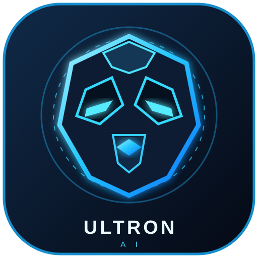

# ULTRON AI

  

<b>Your personal autonomous Android coding agent.</b> Plan • Code • Automate • Build

## Features
- OpenRouter-powered tool-calling agent.
- Explicit approval dialog before every tool execution.
- Sandboxed project workspace with path-traversal protection.
- Android Accessibility bridge for reading visible UI text, exact-label taps and system navigation.
- Voice input using Android speech recognition.
- GitHub Actions APK compilation and in-app build status / artifact monitoring.
- API keys and GitHub token stored using AndroidX EncryptedSharedPreferences.

## Build an APK
1. Open **Actions → ULTRON Android APK**.
2. Run the workflow, or push a commit to `main`.
3. Download the `ULTRON-AI-APK` artifact.

The build uses Java 17 and Gradle 8.7 on GitHub-hosted runners. The workflow dispatch event must exist on the default branch before the app can trigger it.

## Configure ULTRON
In the app Settings:
- OpenRouter API key and a model that supports OpenAI-compatible tool calling.
- GitHub fine-grained personal access token with **Actions: Read and write** for this repository.
- Repository name: `xsoftwareabdullah1-create/Core-ai`.

Do not paste keys into chat or commit them. Store them only in the app's encrypted settings.

## Enable phone controls
Open Android Settings → Accessibility → ULTRON Screen Control. Android shows its own disclosure and permission screen. ULTRON asks for approval before each accessibility tap/navigation, app launch, file write/delete, or build trigger.

## Safety and limitations
- The agent does not bypass lock screens, OTPs, payment prompts, Android permission dialogs, or secure app surfaces.
- Screen context currently comes from the live Accessibility UI tree; apps can hide text from accessibility. This is not continuous video recording or pixel-perfect visual understanding.
- Project files live in ULTRON's private workspace. The current APK workflow builds this ULTRON repository; a separate project-export/build target is a follow-on feature.
- The debug APK is installable for testing. The unsigned release APK is not Play-Store ready and needs signing.
- Android voice recognition availability depends on the device's speech-recognition provider and language support.

## Tech
Kotlin • Jetpack Compose • AndroidX Security Crypto • OpenRouter • GitHub Actions
