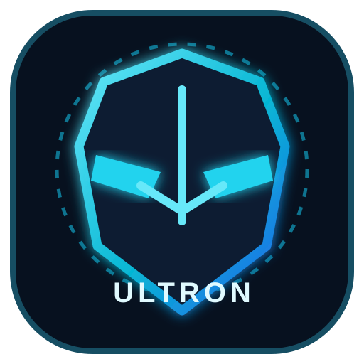

# ULTRON AI
### Your Personal AI Coding & Automation Assistant

**Think. Code. Build. Automate.**

*A mobile-first AI agent project designed to help you create code, manage project files, understand your screen and automate Android tasks—with user approval for sensitive actions.*

---

## ✨ Vision

ULTRON AI aims to bring an AI-powered development workspace to Android. Chat with your AI, describe an app or game, work with project files, inspect your screen and build Android projects through a connected build pipeline.

The project is under active development. Features marked **Planned** are goals, not claims of completed functionality.

## 🚀 Project capabilities

| Capability | Status |
|---|---|
| OpenRouter chat integration | Foundation |
| Encrypted API-key preferences | Foundation |
| Voice input | Foundation |
| User-approved screen capture and image analysis | Foundation |
| Private app workspace file operations | Foundation |
| Android accessibility service integration | Foundation; approval flow being developed |
| Autonomous AI tool planning and execution loop | Planned |
| Per-action approval queue for taps, typing and gestures | Planned |
| GitHub Actions APK build pipeline | Workflow setup in progress |
| In-app build dispatch and live build monitoring | Planned |
| AI-assisted build-log diagnosis and repair | Planned |

**Safety first:** ULTRON must never silently tap, type, install, delete or run potentially destructive actions. Sensitive device actions should be shown to the user with a clear explanation and require explicit approval.

## 🧠 Planned agent workflow

1. Understand the user's request.
2. Create a structured plan and identify required tools.
3. Show sensitive Android actions in an approval queue.
4. Execute only approved actions.
5. Read results and report what happened.
6. For supported projects, trigger a remote GitHub Actions build.
7. Display build status and provide the APK artifact when the workflow succeeds.

## 🛠️ Tech stack

- **Kotlin** — Android application logic
- **Jetpack Compose** — modern native UI
- **OpenRouter API** — model access (model availability depends on provider)
- **Android Accessibility Service** — permission-based UI interaction
- **MediaProjection** — user-consented screen capture
- **GitHub Actions** — remote Android build automation
- **AndroidX Security Crypto** — encrypted preference storage

## 📱 Requirements

- Android 8.0 (API 26) or newer
- Internet connection for remote AI features
- An OpenRouter API key and a supported model
- Explicit Android permissions for screen capture and accessibility features
- A GitHub repository with Actions enabled for remote APK builds

## ⚙️ Setup

1. Fork or clone this repository.
2. Open the project in Android Studio or another compatible Android Gradle environment.
3. Sync the Gradle project.
4. Run the app on an Android device.
5. Add your OpenRouter API key inside the app's settings.
6. Choose a model that supports the features you intend to use.

Never commit API keys, access tokens, passwords or other secrets to the repository. Use encrypted local storage for personal API credentials and GitHub Actions Secrets for CI credentials.

## 🏗️ Build APK with GitHub Actions

The repository is intended to build the Android app remotely using GitHub Actions, so a local Android Studio installation is not required on the phone.

1. Open the **Actions** tab in this repository.
2. Select the Android build workflow.
3. Run the workflow if manual dispatch is enabled, or push a commit to a configured trigger branch.
4. Wait for the workflow to finish.
5. Open the successful run and download its APK artifact.

A downloadable APK is available only after a successful workflow run. Build status and artifact availability are not guaranteed until CI has been tested.

## 🔐 Permissions & privacy

- API credentials should remain on-device in encrypted storage.
- Screen capture requires Android's system consent prompt.
- Accessibility access is optional and must be enabled by the device owner in Android Settings.
- Tool execution should be limited to the user's request and approved actions.
- Avoid sending private screen content or project files to an AI provider unless the user chooses to do so.
- Never store secrets in source code, logs or screenshots.

## 🗺️ Roadmap

- [ ] Complete autonomous tool-calling loop with bounded execution
- [ ] Add human-readable action approval cards
- [ ] Add approved tap, swipe, type and app-launch actions
- [ ] Add GitHub Actions build dispatch
- [ ] Add in-app build progress, logs and artifact download
- [ ] Add build error analysis and suggested fixes
- [ ] Improve project generation for Android apps and games
- [ ] Add tests, accessibility checks and security review

## 🤝 Contributing

Bug reports, ideas and pull requests are welcome. Please describe the problem, expected behavior and steps to reproduce it. Do not include private API keys, personal data or confidential project files in issues.

## 📄 License

This project is licensed under the **MIT License**. See [LICENSE](LICENSE) for the complete terms.

The MIT License permits reuse, modification and redistribution, including commercial use, provided the required copyright and license notices are retained. It does not prevent others from copying the code.

---

**Built with curiosity by Ultra Abdullah**

*ULTRON AI — Build beyond limits.*

